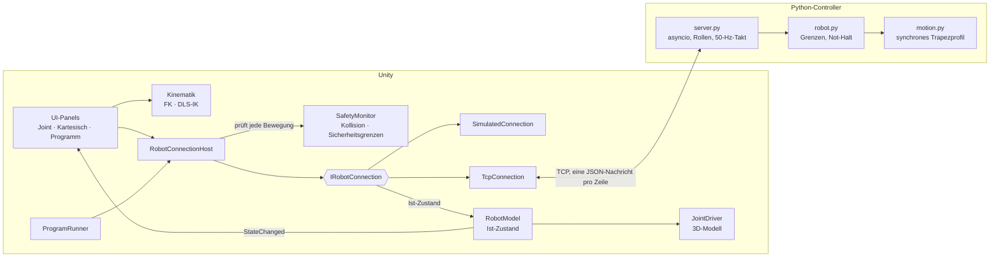

# RoboTwin

Digitaler Zwilling eines 6-Achs-Roboterarms (UR5): **Unity** zeigt und bedient den Roboter,
ein **Robotercontroller in Python** bewegt ihn – verbunden über ein eigenes, dokumentiertes
TCP-Protokoll. Die Netzwerkschicht ist austauschbar: Derselbe Roboter läuft wahlweise komplett
in Unity oder ferngesteuert über den Python-Controller.

## Zweck

RoboTwin ist ein digitaler Zwilling eines 6-Achs-Industrieroboters in Unity. Der Arm lässt sich über eine Bedienoberfläche achsweise oder über Zielkoordinaten steuern und Bewegungsprogramme abfahren. Über eine austauschbare Netzwerkschicht spricht die Simulation per TCP mit einem Robotercontroller in Python und zeigt dabei immer den gemeldeten Ist-Zustand an.

Das Projekt zeigt, wie sich Game-Engine-Technologie für Robotik und Automatisierung einsetzen lässt: zum Testen von Abläufen ohne echte Hardware, für Schulungen und als Grundlage, um später einen realen Roboter anzubinden.

## Funktionen

- **Joint-Modus:** Achsen einzeln per Slider; alle Gelenke starten und stoppen gemeinsam
  (synchrone Bewegung) mit Trapezprofil. Beschleunigen, fahren, bremsen. Geschwindigkeits-Override.
- **Kartesischer Modus:** Zielposition X/Y/Z im Basis-System des Roboters eingeben; eigene inverse
  Kinematik (Damped Least Squares) mit Werkzeugorientierung „nach unten“ oder „beibehalten“.
  Zielmarker zeigt vorab grün/rot, ob das Ziel erreichbar ist.
- **Programme (Teach-Pendant-Prinzip):** Positionen speichern, bearbeiten, abspielen, pausieren,
  wiederholen; Speichern und Laden als lesbares JSON.
- **Simulation oder Netzwerk:** Umschalten zur Laufzeit. Im Netzwerkmodus rechnet der
  Python-Controller die Bewegung; Unity zeigt nur den gemeldeten Ist-Zustand. Mehrere Clients:
  einer steuert, die anderen schauen zu.
- **Sicherheit:** Achsgrenzen (Befehle werden abgelehnt statt still begrenzt), Not-Halt in Unity
  (Button oder `Esc`) und an der Konsole des Controllers, Kollisionsprüfung mit Tisch und Boden
  (vor dem Fahren und laufend), Sicherheitsgrenzen gegen Selbstkollision, Watchdog und
  automatische Neuverbindung bei Verbindungsabbruch.

## Schnellstart

**Voraussetzungen**

| Werkzeug | Version | wofür |
|---|---|---|
| [Unity Hub](https://unity.com/download) + Unity | **6000.6.9f1** (Unity 6.6) | Unity-Projekt |
| [Python](https://www.python.org/downloads/) | ≥ 3.10, keine weiteren Pakete | nur für den Netzwerkmodus |
| Git | beliebig | Klonen |

**1. Klonen**

```bash
git clone https://github.com/eXtn76/RoboTwin.git
```

**2. Unity-Projekt öffnen:** Unity Hub → *Add* → *Add project from disk* → Ordner
`RoboTwin/RoboTwin-Unity` wählen und öffnen. Beim ersten Öffnen lädt Unity die Pakete
(u. a. URDF Importer, Newtonsoft Json). Dies benötigt eine Internetverbindung sowie einige Minuten Zeit.

**3. Szene starten:** Im Project-Fenster `Assets/Scenes/Main.unity` öffnen, **Play** drücken.
Der Roboter läuft jetzt in der Simulation – zum Ausprobieren: Panel *Programm* →
Datei `demo_pick_and_place.json` → *Laden* → *Start*.

**4. Netzwerkmodus (optional):** In einer Konsole im Ordner `controller/`:

```bash
python -m robotwin_controller
```

Dann in Unity oben links den Modus **Netzwerk** wählen → „Verbunden“, Rolle „Besitzer“.
Jetzt rechnet Python die Bewegung; im Konsolenfenster des Controllers löst `estop` einen
Not-Halt aus, `reset` quittiert.

**Python steuert, Unity schaut zu:** Unity auf *Simulation* stellen, Controller starten, in einer
zweiten Konsole `python client.py` (Test-Client, `help` zeigt die Befehle), danach Unity auf
*Netzwerk* stellen – Unity wird Beobachter und folgt jeder Bewegung, die der Client befiehlt.
`python client.py --demo` spielt eine feste Abfolge ab.

## Bedienung

| Was | Wie |
|---|---|
| Kamera drehen / zoomen | rechte Maustaste ziehen / Mausrad |
| Not-Halt | roter Button oder `Esc`; danach *Quittieren* |
| Achsen fahren | Panel links: Slider oder Zahl ins Feld; *Home* = alle Achsen 0° |
| Kartesisch fahren | Panel rechts oben: X/Y/Z (mm, Basis-System, Z nach oben), *Fahren* |
| Programm teachen | Roboter positionieren → *Position speichern*; Name, Speed, Wartezeit pro Punkt |
| Panels einklappen | Pfeil neben der Überschrift; Not-Halt und Meldungen bleiben sichtbar |
| Kollisionsmodell ansehen | Scene-Ansicht, *Gizmos* an: Kapseln (grün/rot) und Hindernisse |

## Architektur



**Leitlinien**

- **Soll und Ist sind getrennt.** Die Oberfläche äußert nur Wünsche (Sollwerte); der Controller
  entscheidet und meldet den Ist-Zustand. Unity zeigt immer, was der Controller meldet.
- **Die Oberfläche kennt nur `IRobotConnection`.** Ob dahinter die Simulation in Unity oder der
  Python-Controller steckt, entscheidet allein der `RobotConnectionHost`. Eine weitere Verbindung
  (z. B. ROS 2 oder ein echter Arm) ist eine weitere Klasse, sonst ändert sich nichts.
- **Ablehnen statt begrenzen.** Ein Befehl außerhalb der Grenzen wird mit Grund abgelehnt –
  der Roboter fährt genau wie befohlen oder gar nicht.
- **Threads:** Der TCP-Empfang läuft in einem eigenen Thread und übergibt Zeilen über eine
  thread-sichere Warteschlange. Alle Events entstehen in `Tick()` im Haupt-Thread – Unity-Objekte
  werden nie aus einem anderen Thread angefasst.

| Schicht | Ordner (`RoboTwin-Unity/Assets/Scripts/`) | Inhalt |
|---|---|---|
| Modell | `Model/` | `RobotModel` (Ist-Zustand), `JointDriver` (Gelenk drehen), `JointMotionSimulator` |
| Kinematik | `Kinematics/` | `Frame`, `KinematicChain` (FK), `IkSolver` (DLS), `CartesianController` |
| Verbindung | `Connection/` | `IRobotConnection`, `SimulatedConnection`, `TcpConnection`, `ProtocolCodec`, `RobotConnectionHost` |
| Sicherheit | `Safety/` | `CollisionChecker` (Kapselmodell), `SafetyMonitor` |
| Programme | `Programs/` | `RobotProgram`, `ProgramFile` (JSON), `ProgramRunner` (Zustandsmaschine) |
| Oberfläche | `UI/` | Panels (UI Toolkit), `OrbitCamera`, `TargetMarker` |

## Protokoll

TCP, standardmäßig `127.0.0.1:5005`, eine JSON-Nachricht pro Zeile, Winkel in Grad.

| Richtung | Nachrichten |
|---|---|
| Client → Controller | `move_joints`, `stop`, `set_override`, `emergency_stop`, `reset` |
| Controller → Client | `hello` (Version, Rolle, Grenzen), `ack`, `error`, `state` (50 Hz), `role` |

Vollständig mit Fehlercodes und Beispielsitzung: [`docs/PROTOCOL.md`](docs/PROTOCOL.md).
Das Programmformat: [`docs/PROGRAM_FORMAT.md`](docs/PROGRAM_FORMAT.md).

## Sicherheit

| Schutz | wo | Verhalten |
|---|---|---|
| Achsgrenzen (URDF) | Controller (Unity-Simulation und Python) | Ziel außerhalb → `joint_limit`, keine Bewegung |
| Not-Halt | Unity (Button, `Esc`), Controller-Konsole (`estop`), Test-Client | sofort stehen, alle Fahrbefehle gesperrt bis *Quittieren* |
| Verbindungsverlust | Python-Controller, Unity | Controller hält an, wenn der steuernde Client wegfällt; Unity erkennt Stille nach 1 s (Watchdog) und verbindet neu |
| Kollision mit Tisch/Boden | Unity (`SafetyMonitor`) | Bahn vorab geprüft und ggf. nicht gesendet; laufende Überwachung löst Not-Halt aus |
| Selbstkollision | Unity (`SafetyMonitor`) | Sicherheitsgrenzen Ellbogen ±145°, Handgelenk 2 ±160° |

Die Sicherheitsgrenzen sind mit den echten Kollisions-Meshes per Stichprobe begründet:
`tools/self_collision_analysis.py` (benötigt `numpy`).

## Tests

Im Ordner `controller/`:

```bash
python -m unittest -v
```

96 Tests: Bewegungsprofil, Grenzen aus der URDF, Protokoll (inklusive Abgleich mit den Beispielen
in `docs/PROTOCOL.md`), Programmdateien (jede Datei in `Programs/` gegen die Achsgrenzen),
Server mit echten TCP-Verbindungen, Test-Client gegen den Controller.

## Projektstruktur

```
RoboTwin/
├── RoboTwin-Unity/          Unity-Projekt (Unity 6.6, URP, UI Toolkit)
│   └── Assets/
│       ├── Robots/UR5/      URDF, Meshes (Universal Robots, BSD-3)
│       ├── Scenes/Main.unity
│       ├── Scripts/         Model, Kinematics, Connection, Safety, Programs, UI, Editor
│       └── UI/              UXML-Layouts und Stylesheet
├── controller/              Python-Controller, Test-Client, Tests
├── docs/                    Protokoll und Programmformat
├── Programs/                Roboterprogramme (JSON)
└── tools/                   Selbstkollisions-Analyse
```

## Grenzen

- **Bewegung:** Die Simulation rechnet in festen Schritten; ein Ziel wird dadurch 2–5 % früher
  erreicht als theoretisch, und im letzten Schritt springt die Geschwindigkeit von wenigen °/s auf 0.
  Wechselt das Ziel während der Fahrt die Richtung, bremst die Simulation abrupt auf 0.
  Der Override begrenzt nur die Geschwindigkeit, nicht die Beschleunigung.
- **Werte:** Die Beschleunigung (180 °/s²) ist frei gewählt, die URDF enthält keine. Die
  URDF-Grenzen sind vorsichtiger als das UR5-Datenblatt (Handgelenke 180 statt 360 °/s,
  Ellbogen ±180° statt ±360°).
- **Netzwerk:** Kein Login und keine Verschlüsselung; der Controller lauscht deshalb standardmäßig
  nur lokal. Unter Windows schwankt der Abstand zwischen zwei Zustandsmeldungen (15–31 ms,
  Timer-Auflösung), im Mittel sind es 50 Hz. Die Steuerung erhält, wer sich zuerst verbindet.
- **Not-Halt:** Stopp-Kategorie 0 (sofort stehen); echte Roboter bremsen oft kontrolliert (Kategorie 1).
- **Programme** laufen in Unity – trennt sich Unity, endet das Programm (der Controller hält dann an).
  Programmpunkte speichern Gelenkwinkel, keine TCP-Posen.
- **Kollisionsprüfung:** Kapseln entlang der kinematischen Kette, etwas dicker als der echte Arm;
  kein Werkzeug oder Greifer; Hindernisse werden beim Start einmal eingelesen. Geprüft wird nur in
  Unity – der Python-Controller kennt den Tisch nicht.
- **Selbstkollision** wird über Achsgrenzen verhindert, nicht geometrisch geprüft. Die Grenzen sind
  per Stichprobe belegt (2000 Zufallsstellungen, keine Selbstkollision über der Montageebene) –
  eine Stichprobe ist kein Beweis, und die Werte gelten nur für den UR5.
- **Tests:** Der Python-Teil ist automatisiert getestet, der Unity-Teil manuell.

## Ausblick

- Weitere `IRobotConnection`-Implementierungen: ROS 2 oder ein echter Servo-Arm.
- Programme im Controller ausführen: Unity lädt das Programm hoch, Python spielt es ab und meldet
  den Fortschritt – es läuft dann auch ohne Oberfläche weiter.
- Steuerung bewusst übernehmen (`take_control`) statt Rollen nach Verbindungsreihenfolge.
- Lineare Bahnen (`move_linear`) mit IK entlang der Strecke.
- Geometrische Selbstkollision (Kugelbäume oder exakte Meshes), damit die Achsgrenzen weniger
  vorsichtig sein müssen; Sicherheitsfunktionen zusätzlich im Python-Controller.
- Automatisierte Tests für den Unity-Teil (Unity Test Framework).

## Quellen und Lizenz

- RoboTwin: [MIT-Lizenz](LICENSE).
- UR5-Modell (URDF und Meshes): [Universal_Robots_ROS2_Description](https://github.com/UniversalRobots/Universal_Robots_ROS2_Description),
  BSD-3-Clause – siehe [`RoboTwin-Unity/Assets/Robots/UR5/README.md`](RoboTwin-Unity/Assets/Robots/UR5/README.md).
- Import in Unity mit dem [Unity URDF Importer](https://github.com/Unity-Technologies/URDF-Importer).